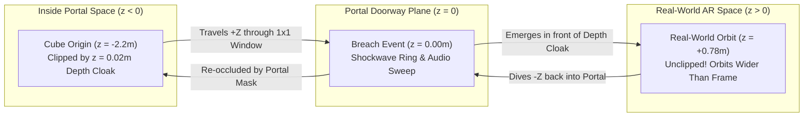
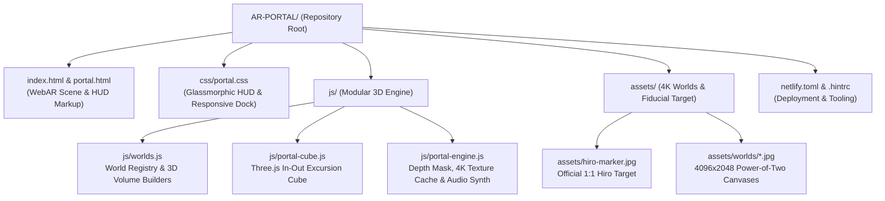

<div align="center">

# 🌀 AR-PORTAL

### **Spatial WebAR Dimensional Portal & Real-World 3D Excursion Engine**

[](https://ar-portal-demo.netlify.app/)
[](./assets/hiro-marker.jpg)
[](https://aframe.io/)
[](https://threejs.org/)

<br />


<p align="center">
  <em>Point your camera at a <a href="https://raw.githack.com/AR-js-org/AR.js/master/data/images/HIRO.jpg">Hiro Marker</a> (or tap <strong>3D Sim Mode</strong>) to open a dimensional window into 4K 360° worlds—complete with a Three.js 3D Tesseract Cube that breaches across the portal threshold out into your physical room.</em>
</p>

</div>

---

## 🧭 Table of Contents

1. [Executive Overview](#-executive-overview)
2. [Quick Start & Hiro Marker Setup](#-quick-start--hiro-marker-setup)
3. [The In-Out 3D Cube Excursion Mechanics](#-the-in-out-3d-cube-excursion-mechanics)
4. [4K Nano Banana Spatial Worlds & Volumetric Modeling](#-4k-nano-banana-spatial-worlds--volumetric-modeling)
5. [Information Architecture & Repository Structure](#-information-architecture--repository-structure)
6. [WebGL Depth-Mask Occlusion & Coordinate Pipeline](#-webgl-depth-mask-occlusion--coordinate-pipeline)
7. [Controls & HUD Reference](#-controls--hud-reference)
8. [Local Development & Deployment](#-local-development--deployment)

---

## ✨ Executive Overview

**AR-PORTAL** is a marker-based and simulated-stage Augmented Reality web application built on **Three.js**, **A-Frame 1.5.0**, and **AR.js**. It transforms a standard [Hiro Fiducial Marker](./assets/hiro-marker.jpg) into a 1×1 meter spatial doorway using hardware-accelerated WebGL depth-buffer masking (`colorWrite: false`).

Key capabilities engineered into this codebase:

- **In-Out 3D Real-World Excursion (`js/portal-cube.js`)**: A multi-layered Three.js 3D Tesseract Cube (inner `#E63946` spinning core, counter-rotating wireframe cage, glassy hull, and 4 orbiting micro-voxels) travels from deep inside the virtual portal (`z < 0`, clipped by the doorway mask), breaches the `z = 0` portal plane with an expanding shockwave ring, and emerges into **real-world AR space (`z > 0`)** where it orbits wider than the portal frame directly over your physical room.
- **4096×2048 Power-of-Two 4K Spatial Canvases (`assets/worlds/`)**: Three bespoke equirectangular panoramic environments generated with **Nano Banana**, upscaled via Lanczos3 with unsharp masking and rendered with 16× hardware anisotropic filtering and native Retina `devicePixelRatio`.
- **Volumetric 3D Interior Modeling (`js/worlds.js`)**: Each world pairs its 4K panoramic dome with multi-depth 3D architectural geometry (`z = -0.5` to `z = -6.0`)—including perspective floor runways, receding neon rings, a 9-layer extruded metallic **IMD Innovation Nexus** logo, a 3D **Earth-Moon Orbital Holomap**, and floating bioluminescent lanterns.
- **Instant Three.js Texture Switching & 3D Sim Mode (`js/portal-engine.js`)**: Direct Three.js `MeshBasicMaterial` texture swapping for zero-latency world transitions on mobile Safari/Chrome, plus a **3D Sim Mode** that lets you orbit the portal and test the In-Out Cube without holding up a physical marker.

---

## 🎯 Quick Start & Hiro Marker Setup

### Option A — Full Camera AR (With Hiro Marker)

1. **Open the Hiro Target** on your laptop/desktop screen or print it on paper:
   - 🔗 **[Open Local High-Contrast Hiro Marker (`./assets/hiro-marker.jpg`)](./assets/hiro-marker.jpg)**
   - 🔗 **[Open Official AR.js Hiro Marker (External Link)](https://raw.githack.com/AR-js-org/AR.js/master/data/images/HIRO.jpg)**
2. **Launch the WebAR App** on your smartphone:
   - 🌐 **[https://ar-portal-demo.netlify.app/](https://ar-portal-demo.netlify.app/)**
3. **Grant Camera Permissions** when prompted and aim your camera at the Hiro marker.
4. **Interact**:
   - Move your phone side-to-side to experience true 6DoF motion parallax inside the portal corridor.
   - Watch the **3D Tesseract Cube** breach out of the portal (`z > 0`) into your room, or tap **`Breach Out (+Z)`** / **`Recall In (-Z)`** in the bottom dock.
   - Tap **`01 · NEXUS`**, **`02 · LUNAR`**, or **`03 · EDEN`** to switch between the 4K spatial worlds.

### Option B — Instant 3D Simulated Mode (No Physical Marker Required)

1. Open **[https://ar-portal-demo.netlify.app/](https://ar-portal-demo.netlify.app/)** on any phone, tablet, or desktop browser.
2. Tap **`3D Sim Mode`** in the top-right HUD bar.
3. The portal locks directly into your 3D viewport (`z = -2.15m`)—drag anywhere on screen to orbit the doorway and watch the 3D Cube breach in and out of the depth-masked portal frame in real time.

---

## 🧊 The In-Out 3D Cube Excursion Mechanics

A signature feature of **AR-PORTAL** is how the Three.js 3D Cube ([`js/portal-cube.js`](./js/portal-cube.js)) interacts with the WebGL depth buffer as it crosses the portal threshold (`z = 0`):



| Z-Depth Region | Spatial State | Visual & Depth-Buffer Behavior |
| :--- | :--- | :--- |
| **`z ∈ [-2.20m, -0.01m]`** | `CUBE: IN PORTAL` | Positioned behind the `z = 0.02m` depth-mask occluder planes. Any part of the cube or its orbiting satellites outside the `1×1` window is occluded by your real-world camera feed. |
| **`z ≈ 0.00m`** | `THRESHOLD BREACH` | Crossing `z = 0` triggers a 3D expanding `THREE.RingGeometry` shockwave on the doorway plane and a Web Audio frequency sweep. |
| **`z ∈ [+0.03m, +0.78m]`** | `CUBE: REAL WORLD` | Positioned **in front of** the `z = 0.02m` depth-mask planes. The cube breaks free of the portal mask, scales up by `1.45×`, and orbits across `x ∈ [-0.56, +0.56]` directly over your physical room while tethered by a quantum line back to `(0, 0, -2.2)`. |

---

## 🌐 4K Nano Banana Spatial Worlds & Volumetric Modeling

Each world in [`js/worlds.js`](./js/worlds.js) combines a `4096×2048` power-of-two panoramic canvas with custom 3D interior geometry:

| World ID | Environment Name | 4K Panoramic Canvas | Volumetric 3D Interior Modeling (`z = 0` to `-6m`) |
| :--- | :--- | :--- | :--- |
| **`01 · NEXUS`** | **Cyber Nexus** | [`assets/worlds/cyber-nexus.jpg`](./assets/worlds/cyber-nexus.jpg) | Reflective perspective runway (`y = -0.49`), neon cyan guide rails, 3 counter-rotating depth rings (`z = -1.2, -2.6, -4.2`), and the 9-layer extruded metallic **IMD Innovation Nexus** core with dual gyroscopes. |
| **`02 · LUNAR`** | **Lunar Outpost** | [`assets/worlds/lunar-observatory.jpg`](./assets/worlds/lunar-observatory.jpg) | Crater regolith telemetry deck, suspended 3D **Earth-Moon Orbital Holomap** (`z = -2.0`) with wireframe latitude cage and inclined orbiting probe, plus floating low-gravity relay monoliths. |
| **`03 · EDEN`** | **Solarpunk Sanctuary** | [`assets/worlds/solarpunk-sanctuary.jpg`](./assets/worlds/solarpunk-sanctuary.jpg) | 3D glass-and-timber suspension boardwalk extending from the doorway (`z = 0` to `-4.8`), golden **Solar-Botanical Octahedral Gyroscope**, and floating bioluminescent lantern orbs. |

---

## 🏛️ Information Architecture & Repository Structure



```text
AR-PORTAL/
├── index.html                        # Primary WebAR application entry point
├── portal.html                       # Mirrored entry point for direct /portal.html links
├── netlify.toml                      # Netlify production publishing configuration
├── css/
│   └── portal.css                    # HUD header, Cube Excursion bar, World Dock & Marker modal
├── js/
│   ├── worlds.js                     # Declarative 4K world configs & 3D spatial volume builders
│   ├── portal-cube.js                # Three.js portal-excursion-cube component (in-out real-world breach)
│   └── portal-engine.js              # Depth-mask shader, 16x anisotropic texture cache, Sim Mode & Web Audio
└── assets/
    ├── hiro-marker.jpg               # Local copy of the official AR.js Hiro fiducial marker
    └── worlds/
        ├── cyber-nexus.jpg           # 4096x2048 4K Cyber Nexus panoramic canvas
        ├── lunar-observatory.jpg     # 4096x2048 4K Lunar Outpost panoramic canvas
        └── solarpunk-sanctuary.jpg   # 4096x2048 4K Solarpunk Sanctuary panoramic canvas
```

---

## 🔬 WebGL Depth-Mask Occlusion & Coordinate Pipeline

1. **The Depth-Buffer Cloak (`depth-mask-material`)**:
   - Four large invisible planes (`THREE.MeshBasicMaterial({ colorWrite: false, depthWrite: true, depthTest: true })`, `renderOrder = -1`) surround the `1×1` portal frame at `z = 0.02`.
   - Because they render first (`renderOrder = -1`) and write `z = 0.02` into the WebGL depth buffer without drawing any color pixels, the real-world camera video shows through while masking any 3D geometry behind `z <= 0.02` outside the `1×1` doorway.
2. **High-Density Curved Projection (`#outside-sphere`)**:
   - Instead of stretching a panoramic image over a full `180°×180°` sphere where 75% of texels are hidden behind the occluders, `#outside-sphere` maps our `4096×2048` texture onto a focused `-Z` dome (`phi-start: 205, phi-length: 130, theta-start: 35, theta-length: 110, radius: 11`) with 16× anisotropic filtering, delivering **3× higher angular pixel density** through the doorway.
3. **Hysteresis Camera Tracker (`portal-visibility`)**:
   - Converts the camera's world position into `#portal-root` local space (`worldToLocal`) every 2 frames and applies a `±0.04m` hysteresis band at `z = 0` to seamlessly swap between `#portal-outside` and `#portal-inside` (full 360° sphere) without boundary flicker.

---

## 🎮 Controls & HUD Reference

| Control | Location | Action |
| :--- | :--- | :--- |
| **`3D Sim Mode`** | Top HUD Bar | Toggles markerless 3D simulation mode so you can orbit the portal and watch the In-Out Cube without a physical Hiro marker. |
| **`Hiro Target`** | Top HUD Bar | Opens an on-screen modal displaying the high-contrast Hiro marker for second-device scanning. |
| **`In-Out Loop`** | Bottom Dock (Top Row) | Autonomous continuous excursion wave (`z = -2.20m ↔ +0.78m`) where the 3D Cube repeatedly breaches out of the portal into your room and dives back in. |
| **`Breach Out (+Z)`** | Bottom Dock (Top Row) | Commands the 3D Tesseract Cube to fly out through the portal doorway and stay hovering in real-world AR space (`z = +0.72m`). |
| **`Recall In (-Z)`** | Bottom Dock (Top Row) | Recalls the 3D Tesseract Cube back inside the virtual portal corridor (`z = -1.75m`). |
| **`01 / 02 / 03` Tabs** | Bottom Dock (Bottom Row) | Instantly swaps the 4K Nano Banana panoramic canvas, portal frame emissive palette, and 3D interior geometry. |

---

## 🚀 Local Development & Deployment

```bash
# Start a local static server on port 8080
npx http-server . -p 8080 -c-1 --cors

# Deploy to Netlify production
npx netlify-cli deploy --prod --dir="."
```

---

## 📜 Credits & Lineage

- **2018 Prototype**: Original Hack@Brown concept inspired by Google's `three.ar.js` spawn-at-camera demo and `THREEx.Portal360`.
- **2025–2026 Architecture by [Royverse](https://github.com/Royverse)**: Re-architected on A-Frame 1.5.0 + AR.js + Three.js with 4K Nano Banana spatial canvases, volumetric 3D interior modeling, hardware depth-mask occlusion, and real-world 3D Cube excursion physics.
